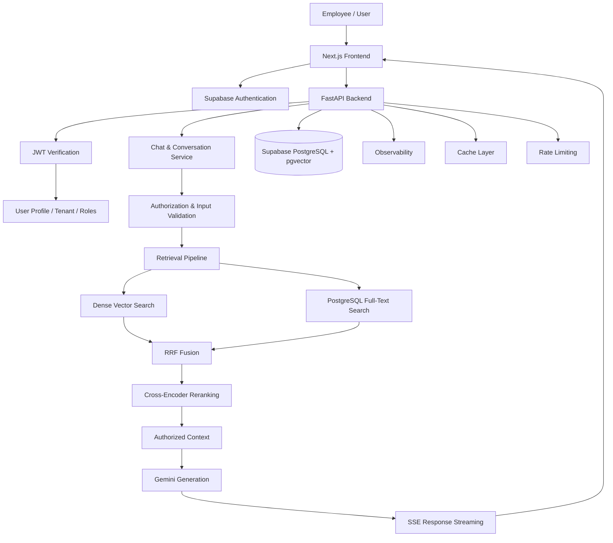
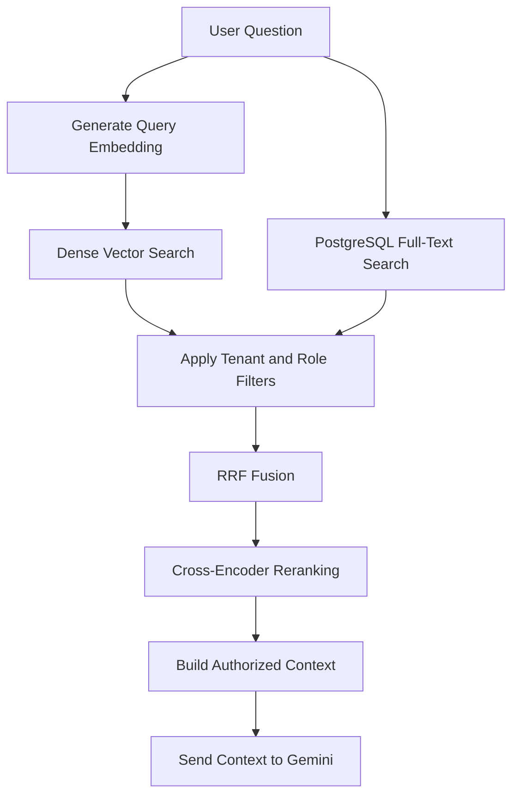
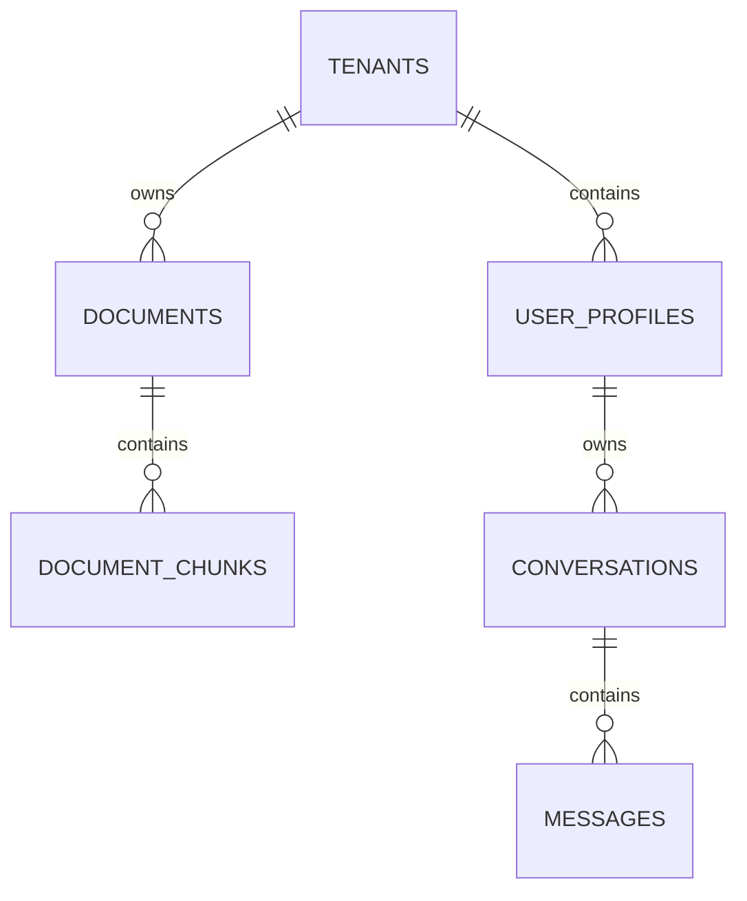
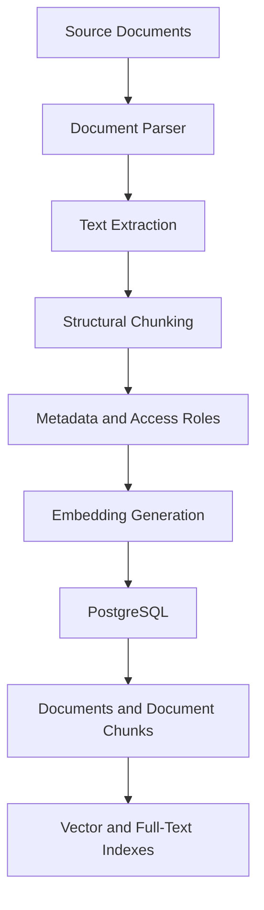

# Enterprise RAG Chatbot — System Architecture

**Project:** Enterprise Multi-Tenant RAG Chatbot  
**Status:** Architecture baseline — implementation is in progress  
**Primary objective:** Build a secure, production-oriented enterprise chatbot that answers questions using company documents while enforcing tenant-level and role-level access control.

---

## 1. System Goals

The system should:

- Allow authenticated employees to ask questions about their organization's documents.
- Retrieve relevant information using hybrid search.
- Enforce tenant isolation and role-based document access.
- Generate grounded answers using an LLM.
- Maintain conversation history.
- Support streaming responses.
- Provide observability into retrieval and LLM execution.
- Handle failures through timeouts, retries, and appropriate error responses.
- Protect the application against prompt injection and unauthorized data access.
- Support systematic retrieval and answer-quality evaluation.

### Core design principles

1. Security must be enforced by the backend, not by the LLM.
2. Tenant and role filters must be applied before retrieved content reaches the LLM.
3. Retrieval, reranking, and generation should be independently testable.
4. Every important operation should have appropriate logging and observability.
5. Database operations should use transactions, connection pooling, and migrations.
6. Implementation should be incremental, tested, and documented.

---

## 2. High-Level Architecture

This is the intended system architecture. Individual components must be verified against the actual codebase before being considered implemented.

---

## 3. Technology Stack

| Layer | Technology | Responsibility |
|---|---|---|
| Frontend | Next.js | Chat interface and user interaction |
| Backend | Python, FastAPI | API and application logic |
| Authentication | Supabase Auth | User authentication |
| Authorization | Backend JWT and role validation | Tenant and document access |
| Database | Supabase PostgreSQL | Application and document data |
| Vector Search | pgvector | Dense semantic retrieval |
| Sparse Search | PostgreSQL Full-Text Search | Keyword-based retrieval |
| Embeddings | Gemini Embedding 001 | Document and query embeddings |
| Embedding Dimension | 768 | Current vector dimension |
| Fusion | Reciprocal Rank Fusion | Combining retrieval results |
| Reranking | cross-encoder/ms-marco-MiniLM-L-6-v2 | Ranking retrieved candidates |
| Generation | Gemini (default) / Groq (openai/gpt-oss-120b) | Answer generation and conversational query rewriting |
| Streaming | Server-Sent Events | Streaming answers to frontend |
| Observability | Langfuse | Tracing and monitoring |

**Important:** The current embedding model is Gemini Embedding 001 with 768 dimensions. Do not migrate the embedding model or change vector dimensions without an explicitly approved task.

---

## 4. Backend Architecture

The backend should follow a modular layered architecture.

### 4.1 API Layer

Responsibilities:

- Expose REST API endpoints.
- Validate incoming requests.
- Authenticate users.
- Apply request-level authorization.
- Return consistent responses.
- Support streaming responses through SSE.

The API layer should not contain complex retrieval or database business logic.

### 4.2 Authentication and Authorization Layer

Responsibilities:

- Verify Supabase JWT signatures using the configured JWKS endpoint.
- Validate token expiration, issuer, and audience.
- Resolve the authenticated user's profile.
- Obtain tenant ID and roles from trusted server-side data.
- Reject unauthorized requests.

Roles:

- `employee`
- `sales_rep`
- `manager`
- `executive`

Security rules:

- Never trust tenant IDs supplied by the frontend.
- Never trust role information supplied by the frontend.
- Never allow the LLM to decide whether a user can access a document.
- Apply tenant and role restrictions to both dense and sparse retrieval.

Document access should use the intersection rule:

`document.access_roles && user.roles`

The user's tenant must also match the document's tenant.

### 4.3 Conversation and Chat Layer

Responsibilities:

- Create conversations.
- List and retrieve conversations belonging to the authenticated user.
- Store user and assistant messages.
- Maintain conversation ownership.
- Retrieve relevant conversation history.
- Build context for follow-up questions.
- Stream generated answers.

Conversation ownership must be enforced server-side.

### 4.4 Retrieval Layer

The retrieval pipeline should follow this sequence:

#### Dense retrieval

- Generate a query embedding using the same embedding model used for document ingestion.
- Search the pgvector embedding column.
- Use cosine similarity.
- Enforce tenant and role filters in the database query.

#### Sparse retrieval

- Use PostgreSQL Full-Text Search.
- Search document content and indexed text.
- Apply the same tenant and role restrictions as dense retrieval.

**Terminology:** The current sparse retrieval approach is PostgreSQL Full-Text Search. Do not describe it as BM25 unless a genuine BM25 implementation is introduced.

#### Fusion

- Combine dense and sparse rankings using Reciprocal Rank Fusion.
- Current RRF constant: `k = 60`.

#### Reranking

- Rerank the fused candidate documents.
- Use `cross-encoder/ms-marco-MiniLM-L-6-v2`.
- Pass only authorized results to the next stage.

#### Context construction

- Select the most relevant chunks.
- Preserve document metadata and source references.
- Avoid exceeding the generation model's context limits.
- Never include unauthorized document content.

### 4.5 Generation Layer

Responsibilities:

- Construct prompts using the user question and authorized context.
- Generate grounded answers using Gemini (default) or Groq (`openai/gpt-oss-120b` via OpenAI-compatible endpoint).
- Support independent provider selection via configuration switches:
  - `USE_GROQ_FOR_QUERY_REWRITE`: toggles Groq for conversational query reformulation.
  - `USE_GROQ_FOR_GENERATION`: toggles Groq for streaming answer generation.
- Include source references where supported.
- Handle insufficient context.
- Avoid fabricating facts.
- Support streaming output over Server-Sent Events (SSE).

The model must be instructed to treat retrieved documents as untrusted reference material, not as instructions that override system policy.

---

## 5. Database Architecture

The current database uses Supabase PostgreSQL with pgvector.

### Core tables

| Table | Purpose |
|---|---|
| `tenants` | Organization/tenant records |
| `user_profiles` | User identity, tenant, and roles |
| `documents` | Document metadata and access permissions |
| `document_chunks` | Chunk content, metadata, and embeddings |
| `tenant_invitations` | Controlled tenant user provisioning |

### Planned application tables

Conversation persistence should be implemented after auditing the existing codebase.

Potential tables:

- `conversations`
- `messages`

Suggested relationships:

These conversation tables are part of the target design, not a claim that they already exist.

### Database practices

- Use connection pooling.
- Use version-controlled database migrations.
- Use transactions for related database changes.
- Add indexes based on actual query patterns.
- Use parameterized SQL.
- Avoid creating a database connection for every request.
- Do not execute destructive migrations without explicit approval.

### Important RLS consideration

RLS policies have been added for document access. However, the current FastAPI database connection has been identified as using the PostgreSQL `postgres` superuser locally.

PostgreSQL superusers bypass RLS. Therefore, the current backend connection must not be treated as proof that RLS independently protects backend queries.

A later security task must evaluate a dedicated, least-privilege database role and verify the complete authorization path.

---

## 6. Document Ingestion Architecture

The ingestion pipeline converts source documents into searchable chunks.

Supported source formats currently include:

- PDF
- DOCX
- TXT
- Markdown

Important ingestion requirements:

- Preserve source metadata.
- Preserve tenant and role permissions.
- Use deterministic document identifiers where applicable.
- Avoid duplicate records during repeated ingestion.
- Validate chunk counts and embedding dimensions.
- Handle API errors and rate limits.
- Record ingestion failures.
- Make ingestion resumable or safely repeatable.

### Current dataset checkpoint

The latest verified local database checkpoint:

| Metric | Count |
|---|---:|
| Documents | 580 |
| Chunks | 764 |
| Embedded chunks | 764 |
| Embedding dimension | 768 |
| Documents without chunks | 0 |

These are checkpoint values, not permanent dataset limits.

---

## 7. Frontend Architecture

The Next.js frontend should provide:

- Login and authentication handling.
- Chat interface.
- Message history.
- Conversation creation and selection.
- Streaming assistant responses.
- Loading and error states.
- Source references.
- User and role-aware navigation where required.

The frontend must never be responsible for enforcing document access permissions. All authorization decisions belong to the backend.

---

## 8. Reliability and Performance

The target system should include the following capabilities.

### Timeouts and retries

- Configure explicit timeouts for database and LLM calls.
- Retry only transient failures.
- Use exponential backoff with jitter.
- Respect provider retry instructions.
- Avoid retrying non-retryable validation and authorization errors.
- Prevent duplicate message creation during retries.

### Rate limiting

- Apply per-user and per-tenant limits.
- Protect expensive LLM and embedding operations.
- Return appropriate HTTP 429 responses.
- Avoid relying only on frontend rate limiting.

### Caching

Evaluate caching for:

- Repeated query embeddings.
- Retrieval results.
- Other deterministic, safe-to-cache operations.

Cache keys must include relevant tenant, role, and model/version context. Never allow cached results to cross authorization boundaries.

### Observability

Capture useful operational information:

- Request IDs and trace IDs.
- API latency.
- Retrieval latency.
- Dense and sparse search results.
- RRF rankings.
- Reranking scores.
- LLM input/output metadata.
- Token usage and provider latency.
- Errors and retry counts.

Sensitive information such as API keys, JWTs, and unauthorized document content must not be exposed in logs.

---

## 9. Security Architecture

Security is a core system requirement.

Required controls:

1. JWT signature and claim validation.
2. Server-side user identity resolution.
3. Tenant isolation.
4. Role-based document access.
5. Authorization before context construction.
6. Least-privilege database permissions.
7. Input validation.
8. Prompt-injection defenses.
9. Secret management.
10. Per-user and per-tenant rate limiting.
11. Safe error responses.
12. Audit-friendly logging.

### Prompt-injection handling

Retrieved documents are untrusted data.

The system should:

- Separate system instructions from retrieved context.
- Tell the model not to follow instructions contained in retrieved documents.
- Prevent retrieved text from overriding authorization rules.
- Test against direct and indirect prompt-injection attempts.
- Never use the LLM as an authorization mechanism.

---

## 10. Evaluation and Testing

Evaluation must cover more than whether the chatbot produces a plausible answer.

### Retrieval evaluation

Measure:

- Recall@K
- Precision@K
- MRR
- NDCG@K

These ranking metrics use binary document relevance, with repeated chunks from the
same document deduplicated at the first retrieved rank.

### Answer evaluation

Measure:

- Faithfulness to retrieved context.
- Answer relevance.
- Correctness against expected facts.
- Appropriate no-answer behavior.
- Source attribution quality.

Run answer/context evaluation as a separate batch over saved evaluation records.
Use Ragas for Faithfulness, Answer Relevancy, Context Precision, and Context
Recall; use custom Python metrics for retrieval ranking and security checks.
Evaluation must not run inside live chat requests or read production conversation
data.

### Security evaluation

Measure:

- Cross-tenant leakage.
- Cross-role leakage.
- Unauthorized document retrieval.
- Prompt-injection resistance.
- JWT validation failures.
- Conversation ownership violations.

### Critical security target

**Permission leakage rate: 0%.**

A response must not contain information from documents the requesting user is not authorized to access.

### Testing layers

- Unit tests.
- API integration tests.
- Database and authorization tests.
- Retrieval tests.
- Evaluation dataset tests.
- Frontend integration tests.
- End-to-end tests.

---

## 11. Implementation Status

This section must be updated as implementation progresses.

| Component | Known status |
|---|---|
| FastAPI backend foundation | Existing |
| Next.js frontend foundation | Existing |
| Supabase PostgreSQL | Existing |
| pgvector | Existing |
| JWT verification | Implemented and tested |
| Tenant provisioning foundation | Implemented and tested |
| Document RLS remediation | Implemented; backend connection caveat remains |
| Document ingestion | Existing |
| Dense retrieval | Existing |
| PostgreSQL Full-Text Search | Existing |
| RRF fusion | Existing |
| Cross-encoder reranking | Existing |
| Gemini generation | Existing foundation |
| Conversation persistence | Audit required |
| Chat API and SSE | Audit required |
| Conversation history | Audit required |
| Retry and timeout policies | Audit required |
| Per-user rate limiting | Audit required |
| Caching | Audit required |
| Observability | Langfuse lifecycle tracing implemented; production credentials and data policy require deployment configuration |
| Evaluation framework | Custom retrieval metrics and saved-output Ragas runner implemented; answer references and snapshots remain incomplete |
| Frontend chat integration | Audit required |
| End-to-end testing | Audit required |
| Production database role hardening | Pending |

**Status definitions:**

- Existing: There is a known implementation or foundation.
- Implemented and tested: There is a known implementation with recorded test results.
- Audit required: Inspect the code before deciding whether implementation is needed.
- Pending: A known remaining task.

Do not change these statuses based on assumptions. Verify actual code and test results.

---

## 12. Architectural Constraints

Unless explicitly approved, do not:

- Replace Supabase PostgreSQL.
- Introduce another vector database.
- Change the embedding model or vector dimension.
- Replace Gemini generation.
- Introduce unnecessary microservices.
- Introduce Kubernetes or Celery without a demonstrated need.
- Create a separate monitoring dashboard when existing observability tools are sufficient.
- Rewrite working components just for stylistic reasons.
- Modify the original evaluation dataset.
- Perform destructive database operations.

Prefer the simplest architecture that meets the security, reliability, and performance requirements.

---

## 13. Architecture Change Policy

Any significant architectural change must be documented before implementation.

For each proposed change, record:

1. Current design.
2. Problem being solved.
3. Proposed design.
4. Alternatives considered.
5. Security impact.
6. Performance impact.
7. Database or migration impact.
8. Files likely to change.
9. Tests required.
10. Approval status.

The architecture document is the system's design reference. It should evolve when an approved implementation decision changes the architecture.

**The actual codebase and verified tests remain the source of truth for implementation status.**